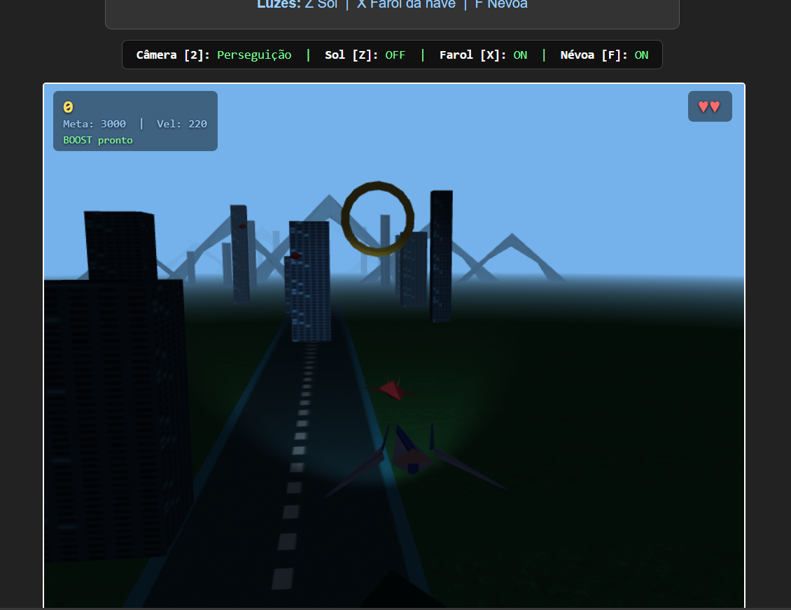
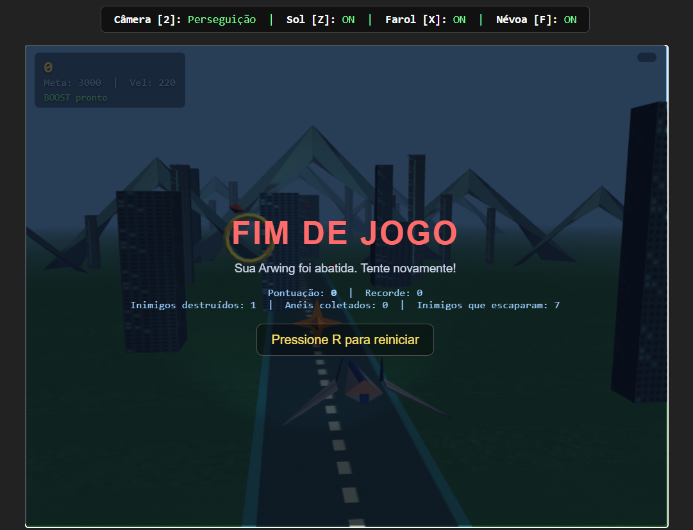

# Relatório — Jogabilidade, interação e pontuação

**Projeto:** Star Fox 3D – Arwing sobrevoando Corneria  
**Tecnologia:** WebGL 2, JavaScript e GLSL ES 3.00  
**Data:** 19/11/2026

## 1. Apresentação

Este relatório apresenta a implementação dos recursos de jogabilidade, interação, pontuação e condições de encerramento desenvolvidos para o projeto **Star Fox 3D**. A aplicação consiste em um jogo de voo em terceira dimensão no qual o jogador controla uma nave Arwing em um cenário urbano inspirado em Corneria.

A versão entregue reúne as mecânicas fundamentais previstas para a proposta: movimentação da nave, disparo de lasers, desvio de obstáculos, enfrentamento de inimigos, coleta de itens, detecção de colisões, sistema de pontuação, condições de vitória e derrota e reinício da partida.

As funcionalidades foram implementadas em WebGL 2 puro, com JavaScript e shaders GLSL escritos manualmente, sem a utilização de engines 3D externas.

## 2. Implementação da jogabilidade

A movimentação da Arwing ocorre nos eixos horizontal e vertical, enquanto o deslocamento do cenário em direção ao jogador produz a sensação de avanço contínuo. A nave permanece limitada ao corredor de voo, impedindo que o jogador abandone a área jogável.

A movimentação é realizada pelas setas do teclado ou pelas teclas `W`, `A`, `S` e `D`. A inclinação visual da nave acompanha os movimentos laterais e verticais, contribuindo para a resposta visual da pilotagem.

O disparo é realizado pelas teclas `Espaço` ou `J`. Cada ação cria dois lasers, posicionados nas laterais da nave, que percorrem o cenário e podem atingir as naves inimigas. Os lasers também receberam iluminação própria e podem contribuir para a iluminação dos elementos próximos da cena.

A tecla `Shift` ativa o impulso de esquiva. O recurso possui duração e recarga, acelera temporariamente o deslocamento visual do cenário e protege a nave contra determinadas colisões durante sua ativação. O estado do impulso é apresentado no HUD da partida.

A aplicação também disponibiliza quatro câmeras de visualização — orbital, perseguição, torre fixa e superior — alternáveis pelas teclas `1`, `2`, `3`, `4` e `C`. Esses modos permitem observar tanto a jogabilidade quanto os elementos visuais do cenário.

## 3. Interações com o cenário e entidades do jogo

O cenário é composto por pista, gramado, prédios, montanhas e torres. Os prédios possuem função visual e também atuam como obstáculos. Eles são reciclados ao longo do eixo de voo, mantendo a continuidade do cenário sem a necessidade de criar uma fase de extensão fixa.

As naves inimigas surgem à frente do jogador e avançam em sua direção com uma variação lateral. O modelo inimigo foi atualizado para um caça low-poly com fuselagem, asas e aletas, substituindo o modelo geométrico simplificado utilizado anteriormente. A orientação do caça permanece voltada para a nave do jogador, tornando sua função hostil mais evidente visualmente.

Os anéis dourados são elementos coletáveis distribuídos ao longo do percurso. A coleta ocorre quando a nave se aproxima o suficiente do item, utilizando a mesma estrutura geral de detecção de proximidade empregada nas demais interações.

As colisões são calculadas no código de jogo por meio de volumes geométricos simplificados. São consideradas as colisões entre laser e inimigo, nave e inimigo, nave e anel e nave e prédio. Cada tipo de interação produz uma consequência específica, incluindo destruição, coleta, perda de vida, penalidade de pontuação e criação de efeitos de explosão.

Após uma colisão com prédio, é aplicada uma breve janela de invulnerabilidade para evitar que a mesma colisão provoque perdas consecutivas. Durante o impulso de esquiva, a nave não sofre o dano correspondente às colisões protegidas pelo recurso.

## 4. Sistema de pontuação

A pontuação é atualizada continuamente durante a partida e apresentada no HUD, junto com a meta de vitória, a velocidade e a quantidade de vidas restantes.

| Evento | Pontuação |
|---|---:|
| Destruição de uma nave inimiga | +100 |
| Coleta de um anel | +75 |
| Fuga de uma nave inimiga | −25 |

A fuga ocorre quando uma nave inimiga ultrapassa a posição do jogador sem ser destruída. A penalidade correspondente impede que o jogador avance apenas evitando os inimigos e reforça a necessidade de utilizar os disparos de forma adequada. A pontuação é limitada inferiormente a zero.

A dificuldade também se ajusta progressivamente conforme a pontuação aumenta, reduzindo o intervalo entre o surgimento dos inimigos até o limite estabelecido pela configuração do jogo.

A meta de vitória da versão atual é de **3.000 pontos**. Esse valor foi ampliado em relação à configuração anterior para aumentar a duração e o desafio da partida.

## 5. Condições de vitória, derrota e reinício

A vitória ocorre quando a pontuação do jogador atinge ou supera a meta de 3.000 pontos. Nesse momento, a partida é interrompida e a interface apresenta a mensagem de vitória, acompanhada do resumo das estatísticas obtidas.

A derrota ocorre quando as três vidas iniciais são perdidas. A interface apresenta a mensagem de fim de jogo e informa a pontuação alcançada, o recorde, a quantidade de inimigos destruídos, os anéis coletados e os inimigos que escaparam.

As telas de início, vitória e derrota possuem estados distintos no fluxo do jogo. A tecla `Enter` inicia a partida e a tecla `R` permite reiniciar uma partida encerrada, restaurando a pontuação, as vidas, as entidades e o estado do cenário.

## 6. Atualização da iluminação e da névoa

Como parte das melhorias visuais desenvolvidas para a versão atual, os lasers passaram a emitir luz pontual de curto alcance. A contribuição luminosa é calculada no fragment shader e enviada para os seis tiros mais próximos da câmera, mantendo o custo de processamento controlado.

Também foi implementada a alteração prevista no planejamento futuro do projeto para a névoa escura. Com o Sol ligado, a névoa utiliza a coloração azul-clara característica da cena diurna. Quando o Sol é desligado pela tecla `Z`, a névoa e a cor de fundo do canvas passam a utilizar uma tonalidade azul-escura, reforçando a ambientação noturna.

A tecla `F` permanece responsável por ativar ou desativar a névoa. Dessa forma, o efeito pode ser comparado durante a execução com o Sol ligado e desligado.

*Figura 1 – Execução durante a partida com `Sol [Z]: OFF` e `Névoa [F]: ON`, evidenciando a ambientação escura, a Arwing e uma nave inimiga no percurso.*

## 7. Registros da execução

A versão jogável foi validada em navegador com suporte a WebGL 2. Durante a execução, o HUD apresenta o estado das fontes de luz, da névoa, da pontuação, da meta, do impulso e das vidas.

A tela de encerramento apresenta uma indicação clara do resultado da partida e permite iniciar uma nova execução por meio do comando de reinício.

*Figura 2 – Tela de derrota com a indicação de fim de jogo, resumo da partida e opção de reinício.*

## 8. Roteiro da demonstração em vídeo

A demonstração deverá apresentar, de forma contínua, os seguintes aspectos:

1. Início da partida e apresentação do HUD.
2. Movimentação da Arwing pelo corredor de voo.
3. Disparo contra uma nave inimiga e atualização da pontuação.
4. Coleta de um anel dourado.
5. Utilização do impulso de esquiva.
6. Interação com os prédios e demonstração da perda de vida em caso de colisão.
7. Comparação da cena com o Sol ligado e desligado, mantendo a névoa ativada.
8. Apresentação da tela de derrota ou, quando possível, da tela de vitória.
9. Reinício da partida por meio da tecla `R`.

A gravação deve priorizar a visualização das mecânicas e das consequências das ações do jogador, permitindo verificar o funcionamento do sistema de pontuação e das condições de encerramento.

## 9. Arquivos e execução

Os principais arquivos relacionados à implementação são:

- `src/game.js`: lógica da partida, controles, entidades, colisões, pontuação e condições de encerramento;
- `src/main.js`: renderização, câmeras, iluminação, névoa e HUD;
- `src/gameGeometry.js`: geometria das entidades do jogo;
- `src/sceneGeometry.js`: geometria do cenário;
- `src/index.html`: interface, instruções e estrutura visual da aplicação.

A execução pode ser realizada abrindo `src/index.html` por meio do Live Server do VS Code ou de um servidor HTTP local, garantindo o carregamento adequado dos arquivos do projeto.

## 10. Considerações finais

A implementação atual atende aos requisitos de jogabilidade, interação e pontuação estabelecidos para a entrega. O jogador possui controle responsivo sobre a nave, dispõe de ações de ataque e esquiva, interage com inimigos, itens e obstáculos e recebe retorno visual sobre o estado da partida.

As regras de pontuação são aplicadas de acordo com os eventos da partida, enquanto as colisões produzem consequências compatíveis com a proposta do jogo. As condições de vitória e derrota são apresentadas de maneira clara, e o reinício permite repetir a experiência sem recarregar a aplicação.

A atualização da névoa escura complementa as melhorias de iluminação e cenário, estabelecendo uma diferença visual clara entre os estados diurno e noturno da cena.
